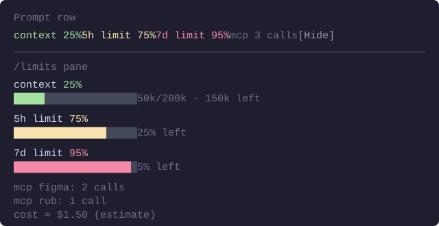

# limit-lines

A Claude Code mod that draws usage as lines. It needs no setup: the data comes from `$.session.usage()` and from the tool calls the session makes.



*Illustration of the layout, not a captured screenshot.*

## What you get

**A row above the prompt.** Context fill and the account's rate-limit windows (5h, 7d) show as coloured percentages, followed by a dim `mcp N calls` item once an MCP tool has been called. A `Hide` button removes the row. The row steps aside while a survey is showing.

**The `/limits` pane.** It shows:
- a full bar for context, with tokens used and tokens left in the window
- a bar for each rate-limit window, with the percentage left
- a cost estimate
- one line per MCP server, busiest first, like `mcp figma: 3 calls`

`/limits` also brings the row back after you hid it.

Colours follow the theme: green below 70%, yellow from 70 to 89%, red from 90%. Change the cutoffs with the plugin options `warnAt` and `errorAt` (in `/config`, or `pluginConfigs` in settings.json). Red never starts below yellow, and a bad value falls back to its default.

## Install

Clone the repo, then start Claude Code with the folder as a plugin directory:

```
git clone https://github.com/margo560/limit-lines.git
cd limit-lines
claude --plugin-dir .
```

The mod is loaded for that session only. To use it every time, pass the same `--plugin-dir` path whenever you start `claude` (for example from a shell alias). Run `/limits` to open the pane.

Requirements: a Claude Code version with mod support (the `claude plugin test` command and `$.session.usage()`). Rate-limit windows need a subscription.

## Things to know

- MCP counts come from a `tool.call` hook, so they cover only calls made while the mod is loaded, and they include calls that were denied or failed.
- Rate-limit windows appear only on a subscription. Without one, the pane says so.
- The hidden row is remembered between sessions. MCP counts last for the session.
- After each turn the mod writes the current lines to `%LOCALAPPDATA%\limit-lines-usage.json` (version, timestamp, each line's percent and colour level, cost, MCP counts) so other programs, such as a desktop widget, can read them. If the write is refused or the variable is missing, the mod carries on without it.

## Develop

Logic lives in `hooks/lines.ts` (thresholds, bar splitting, MCP counting) and the drawing and hooks in `hooks/register.tsx`.

```
claude plugin test .
```

runs the tests in `hooks/lines.test.ts`. The files under `.claude-plugin/types/claude-code*/` are generated by Claude Code and are not tracked.

## License

MIT
